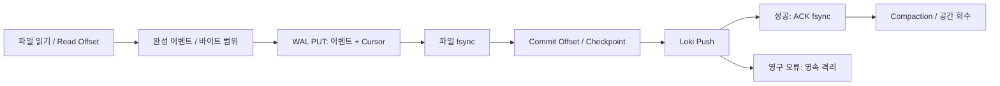

# 아키텍처

## 실행 구조

LoGreedy는 서버당 한 독립 프로세스다. WAS는 파일을 쓰고 Agent는 읽기만 한다. WAS 코드, Java Agent 주입, 네이티브 라이브러리, 외부 수집 서비스에 의존하지 않는다. Source별 경로·Charset·멀티라인·추출 정규식을 적용한다.



Core는 Java 8 API만 사용한다. Legacy는 제한된 ThreadPoolExecutor, Modern은 Virtual Thread Executor와 Semaphore로 작업 수를 제한한다. 현재 전송 작업자는 하나다. 이 선택으로 같은 파일·스트림의 전송 순서를 유지하며, 네트워크 호출 중 Queue 모니터를 잡지 않아 수집과 전송은 독립적으로 진행된다.

## 파일과 바이트 경계

`Tailer`는 파일별 Read Offset, Commit Cursor, CharsetDecoder, 미완성 줄과 멀티라인을 가진다. 기본 64KB Buffer, Poll 1000ms, 파일당 Poll 읽기 한도 256KB다. 전체 파일을 읽거나 해시하지 않는다. 10GB 이상의 위치도 long으로 처리한다.

Decoder는 Buffer 끝의 불완전한 문자를 다음 읽기에 넘긴다. LF와 CRLF의 원문을 보존하며, 개행 없는 마지막 줄은 유휴 Timeout 또는 정상 종료 시 완성한다. 마지막 문자가 덜 들어오면 Commit하지 않는다. 잘못된 인코딩 바이트는 Java Decoder의 replacement 문자로 나타나므로 원본 바이트와 완전히 동일하다는 보장은 없다.

멀티라인 시작 정규식과 매칭되는 줄이 다음 이벤트를 시작하고, 나머지는 이어 붙인다. Timeout·줄 수·크기 한도에서 분리한다. 크기 한도는 문자 하나를 중간에서 자르지 않으므로 Charset의 한 문자 바이트 수만큼 초과할 수 있다. 분할은 버리지 않으며 이벤트 문자열을 이어 붙이면 디코딩한 원문을 복원한다. 제한으로 분할된 이벤트의 의미적 Stack Trace 묶음은 달라질 수 있다.

기존 파일을 처음 만난 최초 Scan은 `begin`/`end`를 따른다(기본 end). 실행 후 발견한 파일은 begin이다. 이미 수집한 Source는 재시작 중 생긴 파일도 begin으로 시작한다. Source 사용 이력은 Cursor가 정리되어도 WAL에 남는다.

## 로테이션 식별

경로를 우선 확인한 뒤 같은 Source의 탐색 후보에서 이전 세대를 찾는다. `BasicFileAttributes.fileKey()`, 경로, 크기, 수정 시각, 최초 최대 256바이트 지문, Commit/Read Offset 직전 최대 256바이트 지문을 조합한다. 크기 감소나 제한 지문 변경은 새 세대로 읽는다. fileKey가 null이면 경로·지문·크기·수정 시각에 의존한다. 원본과 완전히 같은 복사본을 구분하지 못할 수 있다.

파일 핸들은 제한된 읽기 동안만 열고, 이벤트를 임시로 모은 뒤 닫고 나서 Queue/Checkpoint fsync를 수행한다. 한 읽기 묶음은 약 128개 이벤트 또는 파일당 읽기 한도까지이며 남은 Buffer는 다음 Poll에 이어 처리한다. Windows NTFS에서 장기간 열린 핸들이 Rename/Delete를 막는 것을 피한다. 짧은 읽기 중에도 Windows의 공유 모드나 외부 프로그램 정책 때문에 Rename이 일시 실패할 수 있다. GitHub-hosted Windows에서 파일·Queue·로테이션 검사를 통과했으며 실제 WAS와 동시 Rename 운영 부하는 미검증이다. Source에 배타 잠금이나 쓰기 핸들을 사용하지 않는다.

Rename된 파일이 Glob에 맞지 않아도 같은 탐색 범위의 후보에서 찾아 지연 Append를 읽는다. 더 이상 Glob에 맞지 않는 완료 파일 또는 사라진 세대는 유휴 `file.retire.ms` 후 정리한다. 정리된 세대에 뒤늦게 쓰거나 탐색 범위 밖으로 이동한 파일은 추적할 수 없다. Glob에 맞는 파일 수가 `files.max`를 넘으면 발견을 보류하고 진단을 남긴다. Source별 탐색은 깊이와 방문 항목 수를 제한하고 심볼릭 링크를 따라가지 않는다.

다음 상황은 완전한 무손실을 보장할 수 없다.

* 읽기 전에 원본이 삭제되거나 교체되고 이전 파일을 찾지 못한 경우
* Copytruncate의 복사~절단 사이 Append, Poll 사이 절단 후 동일 크기·동일 지문으로 재성장
* fileKey null에서 복사본·교체 파일의 경로·콘텐츠가 구별되지 않는 경우
* 파일 확인과 열기 사이의 Rename/Replace 경합, 관찰 범위 밖 이동, 탐색·파일 수 한도 초과
* Backpressure 동안 원본 보존 기간이 끝나거나, 정리된 세대에 뒤늦게 기록한 경우

Copytruncate보다 Rename 후 새 파일 생성과 충분한 원본 보존 기간을 권장한다.

## Queue와 Checkpoint의 일관성

`queue.wal`이 복구의 기준이다. PUT 레코드에 이벤트와 해당 세대의 Commit Cursor를 함께 넣고 `FileDescriptor.sync()` 후 메모리 상태를 갱신한다. 이후 별도 Checkpoint 스냅샷을 임시 파일에 쓰고 fsync·원자적 Replace한다. 실패하면 Agent는 오류 종료하며, 다음 시작에 WAL을 재생해 Checkpoint를 다시 만든다. WAL이 없는데 Checkpoint만으로 복구하지 않는다.

기록 순서는 이벤트 완성 → PUT 기록 → fsync → Commit Cursor/Checkpoint → Loki → ACK 기록·fsync다. Queue Full 때는 마지막 Commit에서 읽기 상태를 복원하고, Pending/격리 상태에 변화가 생길 때까지 파일 읽기를 중지한다. 디스크 I/O 실패는 Queue를 unhealthy로 만들고 수집·전송을 중단한다. Queue에 들어가지 않은 바이트의 Commit Offset은 앞으로 가지 않는다.

형식 1은 다음 구조다. Java 기본 직렬화를 사용하지 않는다.

```text
Header: magic 0x4C475131 + formatVersion 1
Frame: length(int32) + payload(type byte + fields) + CRC32(int32)
문자열: UTF-8 byteLength(int32) + bytes
Record: PUT / ACK / CURSOR / QUARANTINE / HIGH_WATER /
        FORGET_CURSOR / REPLAY_QUARANTINE / SOURCE_SEEN
```

부분 마지막 프레임만 잘라 직전 완전 레코드로 복구한다. 완전 레코드의 CRC 오류, 잘못된 길이·버전은 자동 삭제하지 않고 시작을 거부한다. 향후 버전은 명시적 형식 판별·마이그레이션이 필요하다. 버전 호환을 추측해서 파일을 덮어쓰지 않는다.

Compaction은 Pending·격리 이벤트, 마지막 Cursor, Source 이력과 ID/시간 High-water를 새 저널에 쓰고 fsync한 뒤 원자적으로 교체한다. Windows를 위해 기존 WAL 핸들을 닫은 후 Replace하며 Spool 잠금은 유지한다. 재시작 때 미완성 `queue.compact`는 기존 WAL 기준으로 폐기한다. Atomic Move를 지원하지 않는 파일 시스템에서는 안전하지 않은 방식으로 우회하지 않고 실패한다.

Directory fsync도 시도한다. Windows 등의 Provider가 디렉터리 열기를 지원하지 않으면 파일 fsync와 Atomic Move만으로 진행한다. 이 경우 전원 장애에 대한 디렉터리 엔트리 영속성은 OS·파일 시스템에 의존한다. 테스트의 `halt`는 프로세스 강제 종료 검사이며 실제 전원 차단 검증이 아니다.

## 전송 보장과 시간

성공한 Loki 요청의 로컬 ACK 전에 종료되면 같은 이벤트가 다시 전송될 수 있다. Exactly-once를 주장하지 않는다. 429·408·5xx·네트워크 실패는 이벤트를 유지하고 Backoff한다. 영구 4xx와 리다이렉트 등은 개별 이벤트를 격리하고 상태 코드를 기록한다. 혼합 Batch의 첫 이벤트를 따로 검사해 전부를 한꺼번에 폐기하지 않는다. 격리도 WAL에 남아 용량을 사용한다.

기본 Loki Timestamp는 수집 시각(`ingest`)이다. 정규식의 원래 Timestamp는 원문과 선택적 Structured Metadata에 보존한다. `parsed` 모드에서는 ISO Offset DateTime을 파싱하고 실패 시 수집 시각을 쓴다. 전송 Timestamp는 WAL의 전역 High-water보다 항상 크게 조정해 스트림 내부 순서를 지킨다. 오래되거나 미래인 Timestamp는 Loki가 거부할 수 있으므로 NTP와 Loki 보존 정책을 확인한다.

Label은 agent, host, environment, application, source의 다섯 가지다. Logger, 경로, Level, 원래 Timestamp와 Message 추출값은 선택적 Metadata이며 Request/Event/Thread ID를 기본 Label로 넣지 않는다. 원문 Message를 JSON 문자열로 전송하고 Gzip한다. Structured Metadata는 호환되는 Loki 설정에서만 활성화한다.
